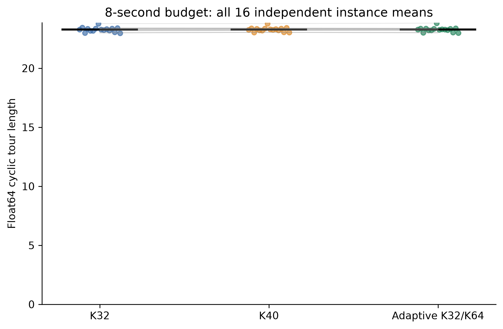
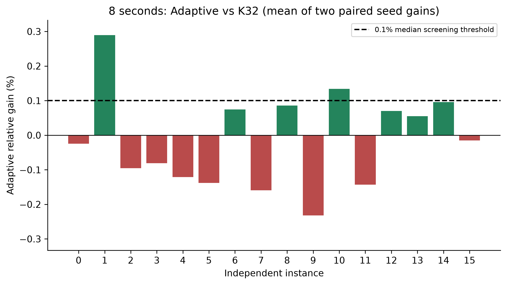
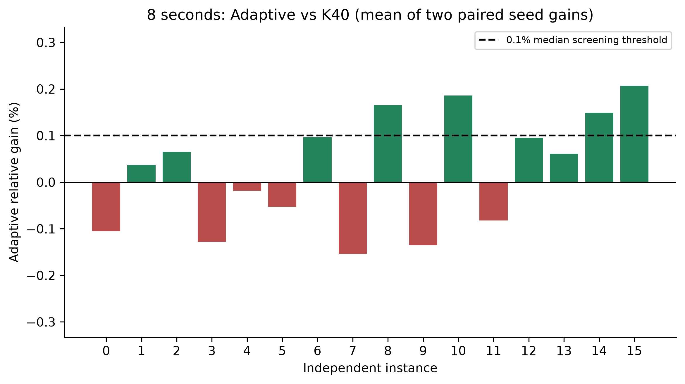
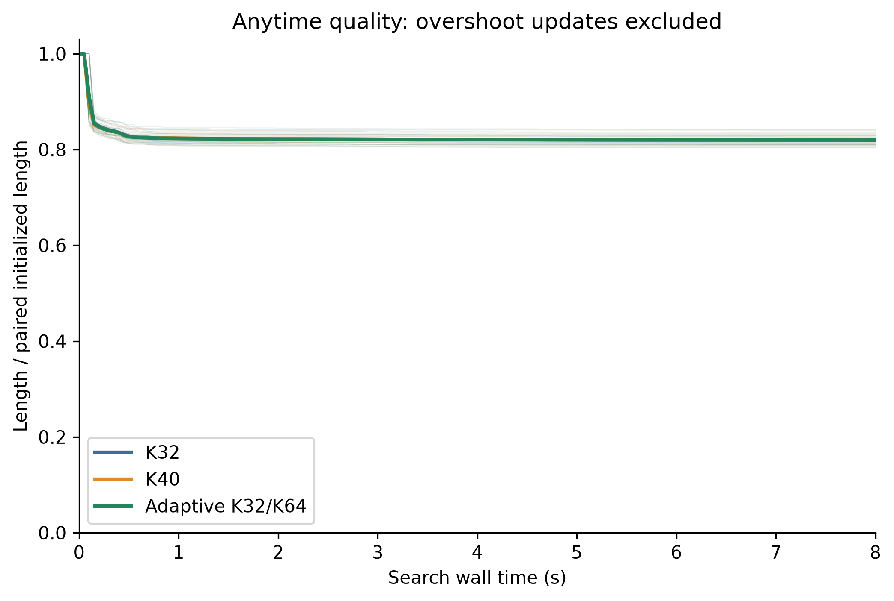
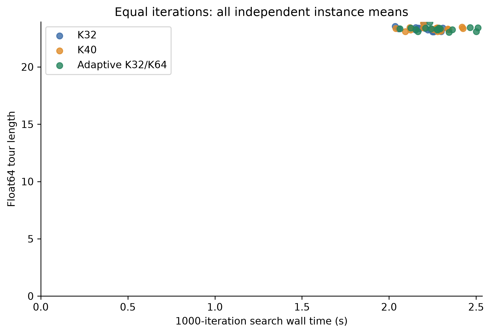
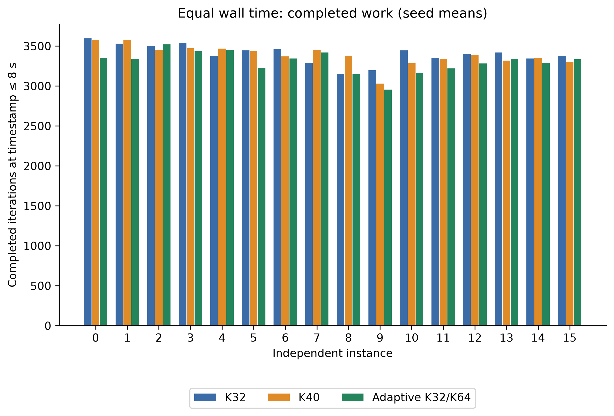
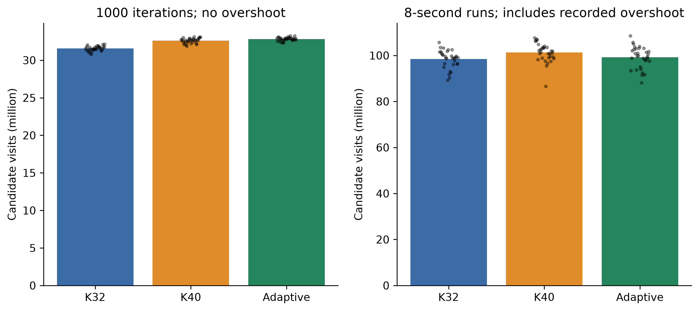
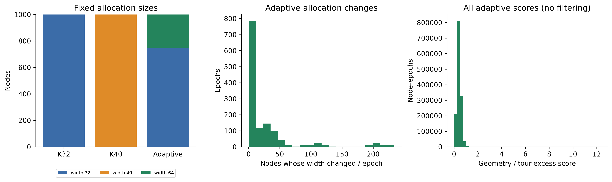

# Báo cáo nghiên cứu R3 final end-to-end

**R3 FINAL DECISION: NO-GO**  
**SCIENTIFIC CONCLUSION: NO-GO**  
Hoàn thành và kiểm toán độc lập **192/192 run hợp lệ**, 16 instance × 2 seed × 3 arm × 2 budget.
Đây là kết luận khoa học theo screening rule đã đóng băng, không phải technical NO-GO.

## 1. Câu hỏi và giả thuyết

Phân bổ có thích nghi 8000 directed candidate slots bổ sung cho SRR có cải thiện
global-best tour của DyNACO so với K32 gốc và K40 đồng ngân sách cạnh hay không?
K32 có 32000 slots; K40 và adaptive đều 40000. Adaptive mở 64 ứng viên ở 250 node,
giữ 32 ở 750 node. So sánh K40 tách hiệu ứng vị trí phân bổ khỏi việc thêm cạnh.

Với tour global-best hiện tại, s(u)=max(d(u, pred(u)), d(u, succ(u)))/
max(mean distance to original K32,1e-12). Xếp giảm dần s, tie theo chỉ số tăng,
lấy đúng 250 node. Cập nhật trước iteration 0,100,200,…; chỉ dùng trạng thái sẵn có.
Khoảng cách allocation tính float64 từ tọa độ float32; native SRR giữ float32.

## 2. Triển khai và kiểm soát

Giữ nguyên nn_list Nx32, backup Nx32, construction, GNN, pheromone và heuristic.
Buffer SRR nối đúng nn_list + backup theo thứ tự native. Template dispatch chỉ
đổi row/width trong hai hướng quét 2-opt. Giữ strict distance early-break,
strict gain tie, max_diff>0, route reversal, checklist extension và RNG.
Không có callback Python trong OpenMP; setter được mutex bảo vệ khi sample.
Đếm tại thread slots rồi cộng sau sample; không race giữa ant. Các arm dùng cùng
instrumentation và đúng một SRR call/ant/iteration, đã kiểm toán toàn bộ grid.

TSP1K,100 ants, K32+backup32, M12, rho=.1, alpha=1, p_best=.05, smooth MMAS,
normalized heuristic, extended checklist, fixed_steps=0, NLS off. Frozen pretrained
checkpoint; không train. Dynamic graph và annealing1→0 trong mỗi 100 iteration,
neural refresh mỗi 100. Equal-wall lặp cùng schedule nếu vượt 1000 iteration.
Giữ duplicate constructor và seed NumPy của utils.infer_instance. Ba arm khởi
tạo độc lập; seed native, source/best, pheromone và native candidates ban đầu
khớp chính xác trong mọi paired group. Không dùng evolving state của arm trước.

## 3. Provenance, môi trường và protocol

- Branch: `codex/r3-final-end-to-end`; executed source commit: `67423537c580717a8407612f0531a92f738e9f53`.
- Reference: `e3eae0055e61789e75a445d61dfa75238ec7ef27`.
- Dataset SHA256: `a9f453a20ce225308ed9282302c3651489bc6f0487990a66a0f2ae7d9618848f`.
- Protocol SHA256: `e23677b760adffabfb06ff4ad03057c3a2d33b684d5a83feb48a98e1883f62cd`.
- Native binary SHA256: `25c6a788672ba240eddef8abe068a66f66f876b6004d26b38e679b94c286ef36`.
- Checkpoint SHA256: `33f7da301e49f74d5b66de2a12c7bd95f247de8c217343c3410bb716a6f22358`.
- Dataset tạo một lần lúc 2026-11-01T08:55:55.023743+00:00; Generator(PCG64(202612070301)),
  một call random((16,1000,2), dtype=float32), C-contiguous; hash từng instance
  trong dataset_manifest.json. Không tái tạo theo kết quả; confirmation cũ không truy cập.
- NVIDIA GeForce RTX 3050 Laptop GPU, VRAM 4.00 GiB; Linux-5.15.167.4-microsoft-standard-WSL2-x86_64-with-glibc2.39.
  Python 3.13.18, NumPy 2.5.4, PyTorch 2.7.1+cu126,
  CUDA 12.6; strict deterministic CUDA, TF32 off,2 CPU/OpenMP threads.

## 4. Technical validation

Full 1000 ARM A đối chiếu binary gốc và utils.infer_instance: exact hash của tất
cả ant routes/costs, source/best, pheromone, heuristic, candidate arrays và prior
ở từng iteration; final arrays cũng exact. Native seed và toàn bộ RNG-derived
trajectory khớp. Candidate validity/prefix/slot budgets, collinear/duplicate
cases, normal/parallel-traced, setter RNG neutrality và resource pilots đều PASS.
Chi tiết: test_results.json và development/. Binary cuối được kiểm tra bổ sung
trong final_binary_verification.json trước principal.

Untimed literal SRR replay trên development ant0: 9
snapshot khớp refined route native chính xác. 284 accepted
float32 moves gồm 220 robust float64 moves,
64 zero-gain và 0 negative float64 moves;
64 event không đổi route. Không sửa historical numerical
semantics. Các con số replay này thuộc development, không phải principal causal effect.

## 5. Timing, scheduling và xử lý lỗi

Equal-iterations chạy trước; instance tăng dần; seed 31415 rồi27182; order ABC/BCA/CAB
theo p mod 3.192 identity đều có atomic completion và hash raw data. Cả192 run đều
hoàn thành ở attempt1; không có failed attempt, retry, exclusion hoặc imputation. Một GPU worker
tuần tự, watchdog 300 s/identity, RSS 4 GiB, torch allocation 3.5 GiB, disk reserve 1 GiB;
không áp cap M2. Log lỗi/retry nếu có được giữ nguyên, không loại theo tour quality.

Search clock perf_counter bao gồm score/setter, graph/neural, transfers, sampling,
SRR, pheromone, CUDA synchronization và lightweight checkpoint recording. Imports,
checkpoint load, original constructor setup, warmup development, float64 recomputation
và serialization được ghi riêng. Adaptive trả toàn bộ score/allocation overhead.
Timestamp hoàn tất được lấy sau checkpoint copying/recording. Có96 run wall
có một iteration overshoot; tất cả vẫn được lưu nhưng không được credit vào metric 8 s.
Anytime 0,1,2,4,6,8 dùng latest completed global-best≤mốc. Native best selection giữ
float32, không chọn lại tour theo float64. Khoảng 8 s là ngân sách chứ không bảo đảm
iteration cuối đúng 8.000000 s; actual search gồm overshoot được báo đầy đủ.

Peak RSS 1.471 GiB;
peak torch CUDA allocation 122.10 MiB.
RSS dùng Linux ru_maxrss (process-lifetime high-water), không giả định đã reset
peak riêng từng run. CUDA allocation peak được reset trước mỗi search.
Warmup records, setup/serialization từng run và GPU snapshots được lưu trong raw_results.

## 6. Kết quả đầy đủ

Mỗi official length được tính lại bằng NumPy float64 trên tọa độ float32 gốc và
tour permutation hợp lệ. Bảng mean length dùng 32 run/arm nhưng uncertainty resample
16 independent instance means. Median là median 16 instance means, không phải32 seed.

| Budget | Arm | Mean length | Median instance length | 95% CI mean length | Iterations hợp lệ | Search s |
|---|---|---:|---:|---|---:|---:|
| iterations | K32 | 23.32759313 | 23.33130327 | [23.239937, 23.423771] | 1000.00 | 2.1988 |
| iterations | K40 | 23.33124896 | 23.33236185 | [23.250713, 23.422300] | 1000.00 | 2.2481 |
| iterations | Adaptive K32/K64 | 23.32192952 | 23.32857411 | [23.237078, 23.419503] | 1000.00 | 2.2820 |
| wall | K32 | 23.27530808 | 23.28156149 | [23.187679, 23.371131] | 3402.03 | 8.0172 |
| wall | K40 | 23.28380417 | 23.28145030 | [23.202868, 23.373771] | 3387.97 | 8.0100 |
| wall | Adaptive K32/K64 | 23.27823256 | 23.28627621 | [23.193688, 23.372720] | 3301.94 | 8.0153 |

Gain theo từng seed là(L_control−L_C)/L_control, sau đó lấy mean hai seed mỗi instance.
Positive nghĩa adaptive tốt hơn. CI là two-sided percentile95% của mean 16 instance
gains,10000 resamples, PCG64(202612070302), cùng index matrix cho mọi comparison.

| Budget | So sánh | Mean gain | Median gain | 95% CI mean | + / − / = instances | Worst | Best |
|---|---|---:|---:|---|---|---:|---:|
| iterations | C_A | 0.0240% | -0.0116% | [-0.0730%, 0.1333%] | 7/9/0 | -0.2568% | 0.6102% |
| iterations | C_B | 0.0401% | 0.0818% | [-0.0303%, 0.1071%] | 10/6/0 | -0.2056% | 0.2318% |
| wall | C_A | -0.0128% | -0.0199% | [-0.0754%, 0.0533%] | 7/9/0 | -0.2320% | 0.2896% |
| wall | C_B | 0.0241% | 0.0487% | [-0.0339%, 0.0832%] | 9/7/0 | -0.1539% | 0.2071% |

## 7. Screening rule đã đăng ký

Chỉ equal wall time quyết định. Cả hai comparison phải đạt cả ba điều kiện:

| Primary 8 s | Median ≥0.1% | Positive ≥12/16 | Bootstrap lower >0 |
|---|---|---|---|
| C_A | -0.0199% (FAIL) | 7/16 (FAIL) | -0.0754% (FAIL) |
| C_B | 0.0487% (FAIL) | 9/16 (FAIL) | -0.0339% (FAIL) |

Kết luận theo đúng rule: **NO-GO**. Equal-iteration là secondary bắt buộc;
nó không thay thế kết quả equal-wall kể cả khi có hướng hiệu ứng khác nhau.

## 8. Search efficiency và cơ chế

| Budget | Arm | ms/iteration | Overhead vs K32 | SRR calls | Candidate visits | Gain evals | Visits rank33–64 | Accepted rank33–64 (float32) | Mean unique undirected edges |
|---|---|---:|---:|---:|---:|---:|---:|---:|---:|
| iterations | K32 | 2.1988 | 0.0000% | 3200000 | 1010037392 | 806706532 | 0 | 0 | 17775.19 |
| iterations | K40 | 2.2481 | 2.2393% | 3200000 | 1043871491 | 839876341 | 39665271 | 443876 | 22170.81 |
| iterations | Adaptive K32/K64 | 2.2820 | 3.7835% | 3200000 | 1050424745 | 846714122 | 46826535 | 389242 | 24166.23 |
| wall | K32 | 2.3596 | 0.0000% | 10889700 | 3150469050 | 2497855854 | 0 | 0 | 17775.19 |
| wall | K40 | 2.3682 | 0.3636% | 10844700 | 3240231614 | 2587546142 | 115802563 | 1229214 | 22170.81 |
| wall | Adaptive K32/K64 | 2.4329 | 3.1082% | 10569400 | 3175777127 | 2539822593 | 128866663 | 1023313 | 24165.44 |

Candidate visits gồm cả neighbor tại early-break boundary; gain evaluations chỉ
đếm sau khi qua distance pruning. Counters wall gồm iteration overshoot, không
nhầm với lượng công việc được credit trước 8 s. Tổng accepted rank33–64 của adaptive
qua hai mode:1412555. Đây là native positive-float32 acceptances, không
đồng nghĩa tour cải thiện robust hoặc global-best được cải thiện nhờ đúng move đó.

Mean số node đổi width giữa hai epoch (bỏ epoch 0):25.45/1000;
median 0.00, range 0–234. Scores và width
của từng node/epoch có trong raw npz; selection frequency trong allocation_node_frequency.csv.
Unique undirected edge counts tính ngoài timed loop từ chính native prefix; khác
với directed slots. Thông tin này không thay đổi policy hoặc timing.

Các đo lường cụ thể cho tradeoff compute/quality:

- C so với K32 tại 8 s: mean gain -0.0128%,
  median -0.0199%; tại 1000 iteration:
  mean 0.0240%.
- C so với K40 tại 8 s: mean gain 0.0241%,
  median 0.0487%; tại 1000 iteration:
  mean 0.0401%.
- C thay đổi runtime/iteration so với K32: 3.1082%,
  so với K40: 2.7346%.
  Trong 8 s, C hoàn tất 3301.94 iteration trung bình,
  K32 3402.03, K40 3387.97.
- Score/allocation cost của C trung bình 51.820 ms/run wall,
  chiếm 0.6465% search time.
  Rank33–64 chiếm 4.0578% candidate visits
  và 4.9302% actual gain evaluations của C.
- Trong untimed development replay, có 4 accepted move ngoài K32,
  trong đó 4 robust float64 improvement.
  Điều này xác nhận cơ chế có thể thực thi move hữu ích, nhưng không chứng minh
  lượng gain đủ bù chi phí trong principal global-best trajectories.

Các số liệu trên cho phép tách hiệu ứng chất lượng theo iteration khỏi throughput
theo thời gian. Chúng không cho phép gán toàn bộ outcome cho overhead hoặc allocator
riêng lẻ. Không có ablation về checklist, allocator khác hoặc full-K64 nên không
thể kết luận đã xác định duy nhất nguyên nhân. Screening rule chỉ đánh giá policy
cụ thể này với cả hai control dưới ngân sách đã định.

Đánh giá nhân quả có giới hạn: end-to-end paired outcomes kiểm tra toàn bộ policy,
không cô lập riêng chất lượng node selection hay checklist. Expanded-candidate
counts chứng minh việc thực thi truy cập; chỉ official float64 gains chứng minh
chất lượng cuối. Những khác biệt overhead/iteration trong bảng giải thích tradeoff
compute quan sát được, không tự chứng minh missing-move headroom hay pruning là
nguyên nhân duy nhất. Nếu gain theo iteration và time khác nhau, cần đọc cả hai
bảng; không viện secondary để đảo primary decision.

## 9. Kết quả từng instance

| Budget | Instance | K32 | K40 | Adaptive | Gain C−A | Gain C−B |
|---|---:|---:|---:|---:|---:|---:|
| iterations | 0 | 23.3304814 | 23.3482179 | 23.3401903 | -0.0419% | 0.0342% |
| iterations | 1 | 23.5301945 | 23.4318503 | 23.3865395 | 0.6102% | 0.1930% |
| iterations | 2 | 23.0824661 | 23.0774450 | 23.0854522 | -0.0129% | -0.0350% |
| iterations | 3 | 23.4030576 | 23.4097119 | 23.3920011 | 0.0472% | 0.0756% |
| iterations | 4 | 23.2253991 | 23.2316390 | 23.2668537 | -0.1785% | -0.1517% |
| iterations | 5 | 23.2339394 | 23.2800184 | 23.2363362 | -0.0104% | 0.1875% |
| iterations | 6 | 23.4379071 | 23.4121607 | 23.3882897 | 0.2117% | 0.1017% |
| iterations | 7 | 23.8265801 | 23.8388153 | 23.8877630 | -0.2568% | -0.2056% |
| iterations | 8 | 23.3321252 | 23.3165058 | 23.2758776 | 0.2410% | 0.1743% |
| iterations | 9 | 23.2745510 | 23.2818261 | 23.3294486 | -0.2359% | -0.2046% |
| iterations | 10 | 23.3579509 | 23.3482220 | 23.3276996 | 0.1296% | 0.0879% |
| iterations | 11 | 23.2254717 | 23.2436958 | 23.2577834 | -0.1394% | -0.0607% |
| iterations | 12 | 23.3970248 | 23.3994913 | 23.4202530 | -0.0995% | -0.0889% |
| iterations | 13 | 23.0628933 | 23.1243799 | 23.0872187 | -0.1056% | 0.1606% |
| iterations | 14 | 23.4595858 | 23.4746872 | 23.4414153 | 0.0774% | 0.1417% |
| iterations | 15 | 23.0618619 | 23.0813167 | 23.0277503 | 0.1470% | 0.2318% |
| wall | 0 | 23.2801811 | 23.2613677 | 23.2859316 | -0.0247% | -0.1056% |
| wall | 1 | 23.4353671 | 23.3760484 | 23.3674866 | 0.2896% | 0.0366% |
| wall | 2 | 22.9981421 | 23.0350897 | 23.0200670 | -0.0953% | 0.0652% |
| wall | 3 | 23.3482797 | 23.3373142 | 23.3670977 | -0.0807% | -0.1278% |
| wall | 4 | 23.1840053 | 23.2077399 | 23.2120524 | -0.1210% | -0.0186% |
| wall | 5 | 23.1842217 | 23.2039187 | 23.2161522 | -0.1378% | -0.0527% |
| wall | 6 | 23.3633804 | 23.3685977 | 23.3459960 | 0.0744% | 0.0966% |
| wall | 7 | 23.7808635 | 23.7821456 | 23.8187350 | -0.1592% | -0.1539% |
| wall | 8 | 23.2829419 | 23.3015328 | 23.2629695 | 0.0857% | 0.1655% |
| wall | 9 | 23.2388800 | 23.2613389 | 23.2928107 | -0.2320% | -0.1353% |
| wall | 10 | 23.3178587 | 23.3300647 | 23.2866208 | 0.1340% | 0.1862% |
| wall | 11 | 23.1952791 | 23.2093802 | 23.2284671 | -0.1431% | -0.0823% |
| wall | 12 | 23.3603004 | 23.3661025 | 23.3438702 | 0.0703% | 0.0951% |
| wall | 13 | 23.0508070 | 23.0521652 | 23.0381175 | 0.0549% | 0.0608% |
| wall | 14 | 23.4055334 | 23.4180639 | 23.3830653 | 0.0959% | 0.1493% |
| wall | 15 | 22.9788881 | 23.0299966 | 22.9822814 | -0.0152% | 0.2071% |

Từng seed/run, timestamps, initial state, overshoot, costs và allocations được lưu
đủ trong raw_results; per_run_results.csv không gộp mất run kém. Không dùng oracle
optimal tour hoặc reference solution; không báo optimality gap không có căn cứ.

## 10. Quan hệ với Stage A và M1/M2

Stage A lịch sử giữ nguyên NO-GO (G0/G4 pass, G1/G2/G3 0/8). Late source snapshots
có 0 missed robust moves ngoài K32, nhưng raw ant0 có off-K32 headroom. Nghiên cứu
mới kiểm tra integrated global-best trajectory trên dataset độc lập; không biến
Stage A thành GO hay thỏa old Stage B gate. Kết quả mới củng cố quyết định không đầu tư thêm vào adaptive policy này trên uniform TSP1K; nó không xác định duy nhất cơ chế thất bại và không phủ định mọi allocator khác.
Các phân phối/trạng thái và primary outcomes khác nhau.

M1 v2 báo exploratory signal trên 32 saved ant0 cases:31/32 robust cases theo bảng
instance (một instance3/4),8/8 instance có robust case; second unchanged K32 pass
khác candidate expansion. Đây không phải end-to-end hoặc equal-compute evidence.
M2 principal lịch sử resource-inconclusive trước launch, không cung cấp xác nhận
hiệu quả. Không trộn sample, p-value, budget hoặc statistical unit giữa các nghiên cứu.
Historical numerical no-op findings vẫn áp dụng: native positive float32 gain
không đủ chứng minh robust improvement; native semantics được bảo tồn.

Nguồn lịch sử: [Stage A report](../../r3/reports/R3_STAGE_A_REPORT.md),
[M1 v2 report](../../r3/m1_additional_k32/v2/M1_V2_RESEARCH_REPORT.md),
[M2 RESOURCE-INCONCLUSIVE report](reproducibility/historical_M2_report.md)
(M2 được trích từ commit c40a034, không phải principal data của nghiên cứu này).

## 11. Giới hạn và quyết định đầu tư

16 uniform Euclidean TSP1K instances và 2 stochastic seeds/instance, một checkpoint,
một GPU. Paired seeds được mean trước thống kê; không coi seed/iteration/move là
independent replicate. Bootstrap có hạn ở n16, correlated criteria là practical
screening chứ không có calibrated familywise error. Không suy rộng mọi TSP distribution,
hardware, checkpoint, allocator hay candidate budget. Wall-time trajectories nhạy
với OS/thermal/GPU scheduling; rotation và common clock giảm bias nhưng không loại
hết.8 s đo short-budget behavior; equal1000 iterations là secondary.

Nghiên cứu chứng minh implementation isolation, complete-grid validity và outcome
theo prespecified rule. Kết quả hỗ trợ empirical direction trong cấu hình này;
chưa xác lập cơ chế duy nhất. Insufficient missed moves, allocation chưa tốt,
checklist/pruning và statistical power là những giải thích cần tách khỏi kết quả
trực tiếp. Không dùng NO-GO làm bằng chứng mọi adaptive allocator đều vô ích.

**Khuyến nghị:** Dừng đầu tư thêm vào đúng adaptive candidate policy K32/K64 này trên uniform TSP1K. Hướng ưu tiên tiếp theo là nghiên cứu SRR scheduling/revisit với equal-compute control và dữ liệu mới; M1 v2 có tín hiệu cơ học trực tiếp hơn nhưng chưa chứng minh hiệu quả end-to-end.

## 12. Hình và tái lập

PNG300dpi và SVG vector; absolute quality axes bắt đầu0 để không phóng đại chênh
lệch nhỏ. Gain plots có zero/negative rõ ràng. Rebuild bằng `python -m r3_final.analyze`
trong môi trường r3/run.sh; không chạy solver lại. Lệnh, hashes và execution log
ở reproducibility/. analysis/raw_integrity_audit.json xác thực toàn bộ192 run.
